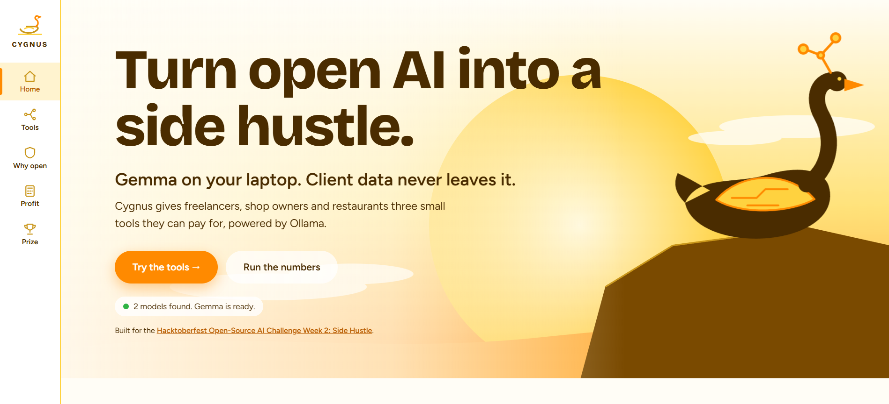
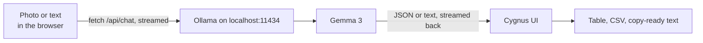

# Cygnus

**Open-weight AI tools small businesses will actually pay for, running on the customer's own laptop.**

> Submission for the **Hacktoberfest Open-Source AI Challenge, Week 2: Side Hustle**
> Preferred Prize category: **Best Use of Gemma** (Gemma served locally through Ollama)



---

## The idea

Freelancers, Etsy and eBay sellers, and small restaurants all have the same kind of chore: a pile of messy inputs (receipts, product photos, menus) that someone has to turn into clean output. They can't easily hand that data to a cloud AI, because it holds client invoices, supplier prices and customer details. Paid APIs also charge per document, which eats the margin of a $9 a month product.

Cygnus is one small web app with three focused tools. Each runs on **Gemma through Ollama**, on the user's own machine.

| Tool | Who pays for it | What it does |
|---|---|---|
| **Receipt Sorter** | Freelancers, bookkeepers | Reads pasted receipt text or a photo and returns vendor, date, total, tax, currency and category as table rows. Exports CSV. |
| **Listing Writer** | Etsy and eBay sellers | Turns product notes and photos into a title (80 characters or fewer), description, 13 tags and a price range. |
| **Menu Translator** | Local restaurants | Translates a menu while keeping the restaurant's own dish names and following its glossary. |

A fourth page, **Will it pay?**, is a small calculator. It compares monthly profit on a paid API with profit running Gemma locally, using your own numbers.

## Why open-source AI matters here

This is the part of the challenge the project is built around.

- **Private by design.** Receipts and product photos are sent only to `localhost`. No server of ours, and no third party, ever sees them.
- **The business math works.** A local model has no per-token bill, so the only marginal cost is electricity. The calculator in the app lets you check this against a paid API with your own numbers.
- **Swappable and tunable.** The model is a dropdown filled from your Ollama install. You can try another Gemma size or any other Ollama model, change the prompts, or fine-tune for a niche. Menu Translator already supports a per-restaurant glossary.
- **Works offline.** After `ollama pull`, the tools need no internet connection.
- **No lock-in.** There is no vendor pricing change or API deprecation that can break a product built on this.

## How it works



- The whole app is one file, `cygnus.html`. There is no build step and no backend.
- The page calls Ollama's `/api/chat` endpoint and reads the streamed response line by line.
- Receipt Sorter asks Ollama for JSON output, parses it into rows, and builds the CSV in the browser.
- Photos are base64-encoded in the browser and sent to Gemma as image input.

## Quick start

**Requirements:** [Ollama](https://ollama.com) and a machine that can run Gemma 3 (the 4B size runs on a typical laptop; larger sizes need more memory).

```bash
# 1. Get the model (use a Gemma 3 size that supports images)
ollama pull gemma3

# 2. Start Ollama and allow the page to call it
OLLAMA_ORIGINS="*" ollama serve

# 3. Open the app
open cygnus.html        # macOS
xdg-open cygnus.html    # Linux
start cygnus.html       # Windows
```

On Windows PowerShell, set the variable first: `$env:OLLAMA_ORIGINS="*"; ollama serve`.

Check the status pill on the home screen. It shows whether Ollama is connected and which Gemma model it found. Then open **Tools**, pick one, press **Use sample**, and press **Run with Gemma** (or Ctrl+Enter).

If it says Ollama is not reachable, check that Ollama is running, that `OLLAMA_ORIGINS` was set before starting it, and that the address in the tool panel matches (default `http://localhost:11434`).

## Using other Ollama models

Gemma is the default, but any model you have pulled into Ollama works:

```bash
ollama pull llama3.2        # or qwen2.5, mistral, phi4, and so on
```

Click the **Model** field in a tool panel. The page re-reads your installed models and lists them. You can also type any model name. Notes:

- **Receipt Sorter** asks for JSON output, so pick a model that follows instructions reliably.
- **Photos** only work with vision-capable models (for example Gemma 3, `llama3.2-vision`, `llava`). Text-only models will fail or ignore the image.
- Quality and speed vary by model size, so compare a few on your own sample data.

## Design

- **Vertical navigation** with a branching, drop-right menu: the Tools item opens a tree of connected nodes, drawn in SVG.
- **White, yellow, orange and gold** palette throughout.
- **All graphics are SVG**: the swan with circuit-trace antlers in the hero, the icons, and the pipeline diagram.
- Responsive, with visible keyboard focus and reduced-motion support.

## Honest limitations

- Gemma can misread blurry receipts or invent a field. Always review the extracted rows before using them for accounting.
- Image input needs a Gemma 3 model that supports vision. Smaller or text-only models will ignore photos.
- The browser talks to Ollama directly, so `OLLAMA_ORIGINS` must allow the page. Setting it to `*` is fine for personal use on one machine, but is too open for shared computers.
- The default numbers in the calculator are examples, not measured figures.
- Prompts are tuned for English input. Menu translation quality depends on the target language and model size.

## About this submission

Cygnus is a solo project, built and submitted for the Hacktoberfest Open-Source AI Challenge, Week 2: Side Hustle. The whole app is in this repository: `cygnus.html` plus this README.

## Built with

[Ollama](https://ollama.com), [Gemma](https://ai.google.dev/gemma) by Google, and plain HTML, CSS and JavaScript.
